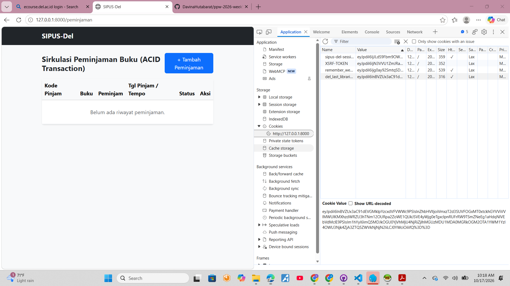
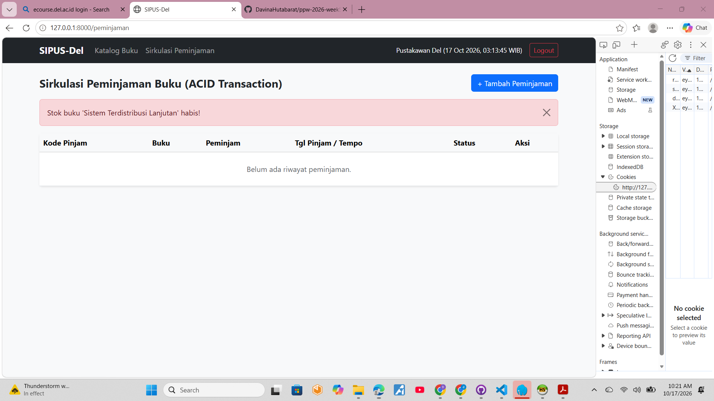
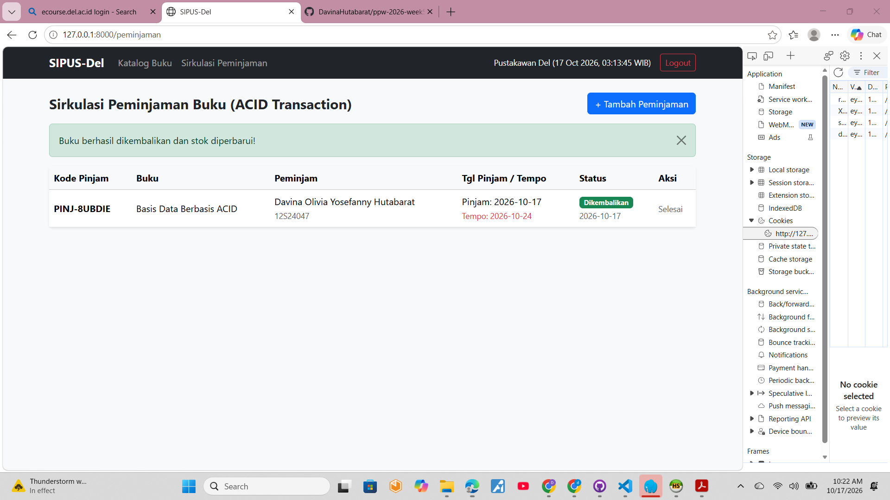

# SIPUS-Del 
**Sistem Informasi Perpustakaan Kampus Del**  
Mata Kuliah: Pemrograman & Pengujian Web (1253101)  
Program Studi Sarjana Sistem Informasi - Institut Teknologi Del  

---

## 1. Identitas Mahasiswa & Kredensial Uji Sistem
- **Nama Mahasiswa**: Davina Olivia Yosefanny Hutabarat
- **NIM**: 12S24047
- **Branch Penugasan**: `week6-db-session`

### Kredensial Akun Pustakawan (Seeder)
- **Email**: `pustakawan@del.ac.id`
- **Password**: `password123`
*(Diinisialisasi melalui `PustakawanSeeder`)*

---

## 2. Struktur Skema Basis Data & Relasi ERD 
Sistem memperluas basis data relasional persisten MySQL dengan menambahkan entitas transaksi peminjaman (`peminjamans`) yang terhubung langsung ke entitas buku (`bukus`):

```text
[ kategoris ] 1 <--- N [ bukus ] 1 <--- N [ peminjamans ]

```

### Definisi Skema Tabel `peminjamans`:

* `id` (BIGINT, Primary Key, Auto Increment)
* `kode_pinjam` (VARCHAR 20, Unique)
* `buku_id` (Foreign Key -> `bukus.id`, `cascadeOnDelete`)
* `nim_peminjam` (VARCHAR 15)
* `nama_peminjam` (VARCHAR 150)
* `tanggal_pinjam` (DATE)
* `tanggal_jatuh_tempo` (DATE)
* `tanggal_kembali` (DATE, Nullable)
* `status` (ENUM: `'dipinjam'`, `'dikembalikan'`)
* `timestamps` (`created_at`, `updated_at`)

### Relasi Model Eloquent:

* **`App\Models\Buku`**: `hasMany(Peminjaman::class)`
* **`App\Models\Peminjaman`**: `belongsTo(Buku::class)` dengan deklarasi eksplisit `protected $table = 'peminjamans';` guna mencegah konvensi pluralisasi bawaan Laravel.

---

## 3. Transaksi ACID & Pessimistic Locking 

Seluruh mutasi stok dan pencatatan sirkulasi dibungkus menggunakan protokol transaksi ACID untuk menjamin integritas data dan mengeliminasi risiko *race condition*:

1. **Peminjaman Buku (`PeminjamanController@store`)**:
* Menjalankan blok `DB::transaction(..., 3)` dengan batas percobaan *deadlock* 3 kali.
* Mengunci baris data buku via `Buku::where('id', $id)->lockForUpdate()->firstOrFail()`.
* **Pencegahan Stok Negatif**: Mengevaluasi ketersediaan fisik (`$buku->stok < 1`). Jika stok habis, melempar `RuntimeException` sehingga transaksi otomatis di-*rollback*.
* **Pencegahan Pinjam Ganda**: Mengunci dan memvalidasi apakah mahasiswa dengan NIM yang sama masih meminjam judul buku yang sama sebelum diizinkan meminjam kembali.
* Mengurangi stok fisik secara atomik melalui `$buku->decrement('stok')` dan mencatat entri baru pada tabel `peminjamans`.
* Menangkap `QueryException` serta mencatat galat teknis ke berkas log via `Log::error()`.


2. **Pengembalian Buku (`PeminjamanController@kembalikan`)**:
* Dibungkus dalam `DB::transaction()` dan penguncian baris `lockForUpdate()`.
* Memulihkan kuantitas stok buku fisik menggunakan `$buku->increment('stok')`.
* Memperbarui status peminjaman menjadi `'dikembalikan'` dan mencatat stempel waktu pengembalian (`tanggal_kembali`).


---

## 4. Rekapitulasi Fluent Query Builder & Optimasi Kueri 

Untuk menghindari masalah performa *N+1 Query* dan menyajikan analitik perpustakaan secara efisien:

* **Kartu Statistik Dasbor**: Dihitung menggunakan agregasi langsung `DB::table()`:
* Total Judul Buku: `DB::table('bukus')->count()`
* Total Stok Fisik Tersedia: `DB::table('bukus')->sum('stok')`
* Total Buku Sedang Dipinjam: `DB::table('peminjamans')->where('status', 'dipinjam')->count()`
* Total Buku Telah Dikembalikan: `DB::table('peminjamans')->where('status', 'dikembalikan')->count()`


* **Agregasi Bebas N+1**: Menggunakan `Buku::with('kategori')->withCount('peminjamans')` untuk menghitung frekuensi sirkulasi tiap buku dalam satu kueri terpadu.
* **Pencarian Dinamis & Paginasi**: Menerapkan klausul kondisional `when()` untuk filter teks (judul, penulis, ISBN) dan filter kategori, serta paginasi `paginate(8)->withQueryString()`.

---

## 5. Manajemen Sesi, Keamanan Cookie, & Autentikasi 

Implementasi pada `AuthController` mencakup standar keamanan web modern:

* **Pencegahan Session Fixation**: Menjalankan `$request->session()->regenerate()` seketika setelah `Auth::attempt()` berhasil memverifikasi kredensial pustakawan.
* **Terminasi Sesi Aman**: Menjalankan `Auth::logout()`, `$request->session()->invalidate()`, dan `$request->session()->regenerateToken()` saat proses keluar sistem.
* **Proteksi Akses (Middleware)**: Memproteksi seluruh rute mutasi sirkulasi dan CRUD dengan `middleware('auth')`.
* **Manajemen State Sesi**: Menyimpan histori pencarian terakhir (`last_catalog_search`), histori NIM peminjam terakhir (`last_borrower_nim`), dan stempel waktu login (`login_timestamp`).
* **Audit HTTP Cookie**: Menyimpan jejak akun pustakawan melalui `Cookie::queue('del_last_librarian_email', $email, 10080)` yang dikirimkan via response header dengan atribut proteksi `HttpOnly` dan `SameSite=Lax`.

---

## 6. Bukti Pengujian Sistem & Lampiran Audit DevTools 

### A. Uji Audit Cookie HttpOnly (Browser DevTools)
Verifikasi keberadaan cookie `del_last_librarian_email` yang dikirim via `Cookie::queue()` serta flag keamanan `HttpOnly` aktif pada cookie sesi untuk memitigasi risiko XSS:



---

### B. Uji Transaksi ACID: Rollback Stok = 0
Verifikasi penolakan peminjaman buku bersisa stok 0 (*Sistem Terdistribusi Lanjutan*) menggunakan pengecekan atomik dan `lockForUpdate()`, memicu `RuntimeException` sehingga seluruh proses di-*rollback*:



---

### C. Uji Transaksi Sirkulasi & Concurrency Locking
Verifikasi siklus peminjaman sukses (stok fisik berkurang secara atomik) dan pengembalian buku berhasil memulihkan stok fisik kembali ke kuantitas semula (`$buku->increment('stok')`) serta memperbarui status menjadi **Dikembalikan**:



```

---

## 7. Panduan Menjalankan Proyek Lokal

```bash
# 1. Pastikan dependensi terpasang
composer install

# 2. Migrasi dan jalankan seeder pengujian
php artisan migrate
php artisan db:seed --class=PustakawanSeeder

# 3. Jalankan server lokal
php artisan serve

```

Akses sistem pada peramban web: `http://127.0.0.1:8000/buku`

```
