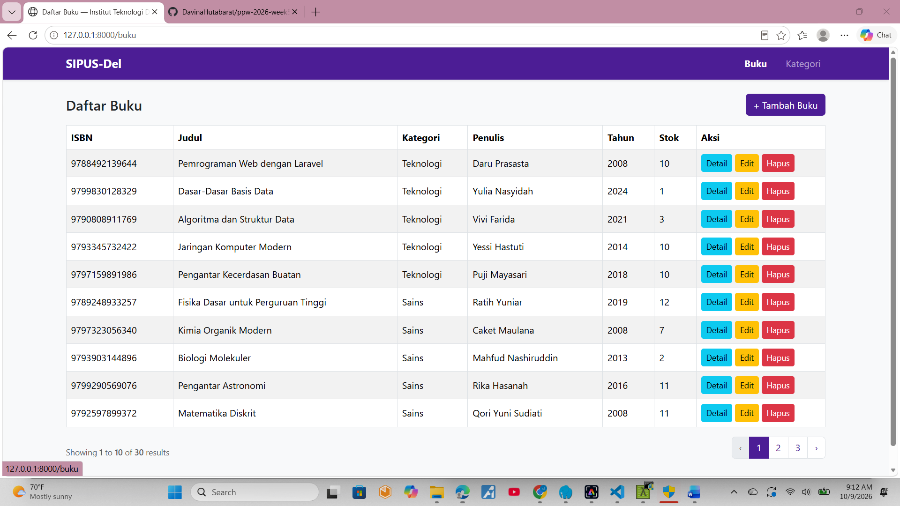
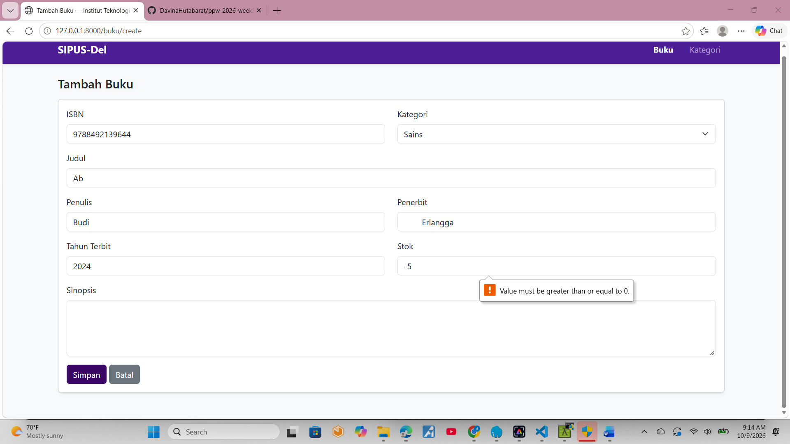
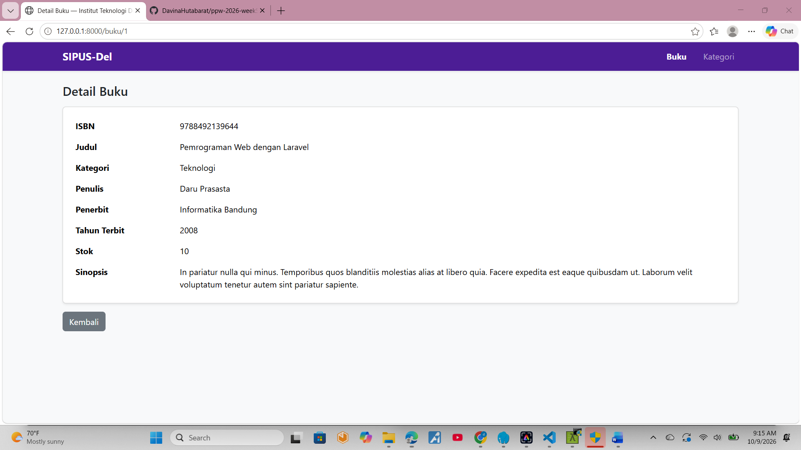
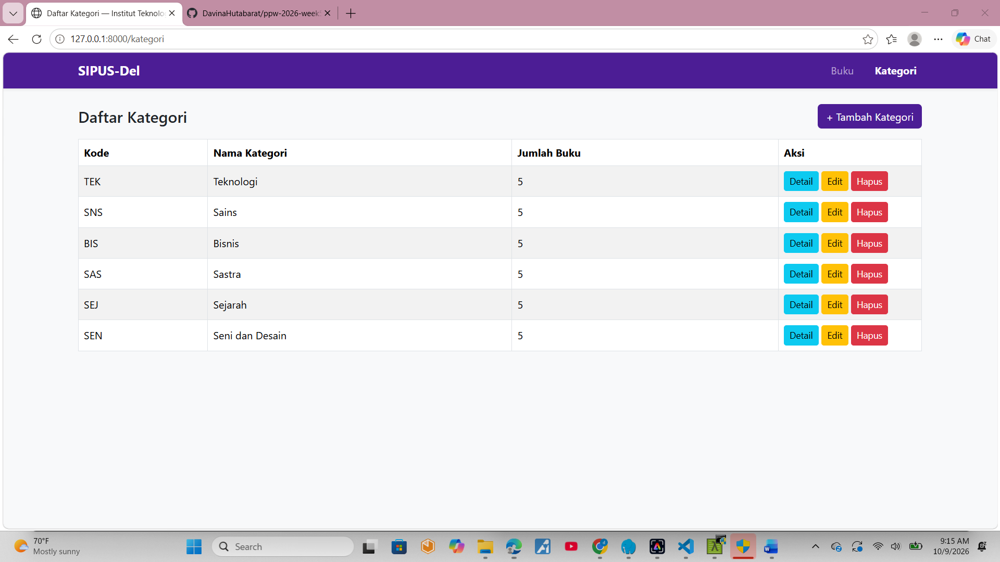

# SIPUS-Del — Sistem Informasi Perpustakaan Kampus Del

Tugas Mandiri Praktikum Minggu 05 — Pemrograman & Pengujian Web (12S3101)
Institut Teknologi Del • Semester Ganjil 2026/2027

Nama : Davina Olivia Yosefanny Hutabarat
NIM  : 12S24047

## Deskripsi
Aplikasi CRUD perpustakaan dengan arsitektur MVC pada Laravel [isi versi dari `php artisan --version`].
Mengelola data **Kategori** dan **Buku** (relasi One-to-Many), lengkap dengan
validasi server-side, proteksi CSRF, Blade Component layout, pagination,
dan pembuktian eager loading terhadap N+1 query problem.

## Fitur
- CRUD Buku dan Kategori (7 route RESTful via `Route::resource`)
- Implicit Route Model Binding
- Validasi server-side (ISBN unik, judul minimal 5 karakter, stok minimal 0)
- Proteksi CSRF dan method spoofing di seluruh form
- Master layout `<x-layout>` bertema Del Purple (#4C1D95)
- Pagination, flash message, dan penanganan data kosong dengan `@forelse`
- Seeder dan Factory: 6 kategori dan 30 buku (Faker)
- Audit kueri SQL (`DB::listen`) untuk membuktikan eager loading

## Teknologi
PHP 8.x, Laravel, SQLite, Blade, Bootstrap 5

## Instalasi
1. Clone repositori:
   git clone https://github.com/DavinaHutabarat/ppw-2026-week5-12S24047.git
   cd ppw-2026-week5-12S24047
2. Pasang dependensi:
   composer install
3. Salin konfigurasi lingkungan:
   cp .env.example .env
   (Windows: copy .env.example .env)
4. Buat application key:
   php artisan key:generate
5. Buat file database SQLite (jika belum ada):
   type nul > database\database.sqlite
6. Jalankan migrasi dan seeder:
   php artisan migrate:fresh --seed
7. Jalankan server:
   php artisan serve
8. Buka http://127.0.0.1:8000

## Struktur Database
- `kategoris`: id, kode_kategori (unik), nama_kategori, timestamps
- `bukus`: id, isbn (unik), judul, penulis, penerbit, tahun_terbit,
  kategori_id (FK → kategoris, cascade delete), stok, sinopsis, timestamps

Relasi: Kategori `hasMany` Buku, Buku `belongsTo` Kategori.

## Bukti Audit SQL (Eager Loading)
- Sebelum: `docs/audit-sql-sebelum-n-plus-1.txt`
  (1 kueri utama + 10 kueri per baris → N+1)
- Sesudah: `docs/audit-sql-sesudah-eager-loading.txt`
  (kueri `bukus` + 1 kueri `kategoris where id in (...)`)

Implementasi: `Buku::with('kategori')->latest()->paginate(10)` di `BukuController@index`.

## Screenshot

### Daftar Buku

### Validasi Form

### Detail Buku

### Daftar Kategori

## Catatan
File `.env` dan folder `vendor/` tidak disertakan di repositori.